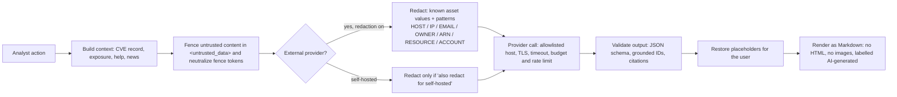

# AI providers & data protection

AI features in ExposureCatalyst are **optional, off by default and admin-controlled**. They assist analysts
and never act autonomously: no feature sends email, changes data or calls tools on the model's
instructions. Every AI output is labelled *AI-generated*.

## Features

| Feature (`route key`) | Where | What is sent |
|---|---|---|
| CVE summaries (`cve_summary`) | CVE detail → AI analysis → Plain English / Executive | CVE record and exposure summary (redacted) |
| Risk narrative (`risk_narrative`) | CVE detail → Risk narrative | Same. Returns a priority P1/P2/P3 with reasoning |
| Remediation guidance (`remediation`) | CVE detail → Remediation | Same |
| Advisory draft (`advisory_draft`) | Advisory editor → Draft with AI | CVE, exposure and advisory metadata (redacted). Returns **suggestions** that the analyst applies field by field. The advisory still needs approval |
| News brief (`news_brief`) | Security News → AI brief | Public headlines and excerpts |
| Natural-language search (`nl_search`) | CVE Intelligence → Ask in plain English | The question only. The answer is validated as search filters |
| Analyst chat (`chat`) | Assistant | The question and the referenced CVE records with exposure (redacted) |
| Ask Help (`help`) | Help Center → Ask Help | The question and the matching help topics the user is allowed to see. Answers cite topics |

## Supported providers

| Group | Providers | Protocol |
|---|---|---|
| Commercial | OpenAI, Anthropic Claude, Google Gemini, xAI Grok, Mistral, Cohere, DeepSeek, Alibaba Qwen, Moonshot Kimi, Zhipu GLM, AI21, Perplexity | OpenAI-compatible (Anthropic: Messages API) |
| Cloud platforms | Azure OpenAI, **Amazon Bedrock** (IAM task role, no stored keys, `pip install exposurecatalyst[aws]`), Google Vertex AI (service account), IBM watsonx.ai (IAM API key), NVIDIA NIM | Azure / Bedrock Converse / token exchange + OpenAI-compatible |
| Inference hosts | Groq, Together AI, Fireworks, Cerebras, OpenRouter, Hugging Face Inference | OpenAI-compatible |
| Self-hosted | Ollama, vLLM, LM Studio, any OpenAI-compatible endpoint | OpenAI-compatible |

!!! note "Verification status"
    Adapters follow each provider's documented API and are covered by mocked tests. Use **Test** in Settings
    with your own credentials before routing features to a provider. Perplexity and OpenRouter forward prompts
    to further parties (web search and third-party models), so consider excluding them through the allowlist.

## Data-sharing and redaction policy

- **Redacted before leaving the platform** (default for every external provider): asset hostnames, IP
  addresses (IPv4 and IPv6), owners and contacts, email addresses, AWS ARNs, instance IDs, 12-digit account
  IDs, and internal host names (`*.corp`, `*.internal`, `*.local`, …). Values known from integration data are
  matched exactly, and the patterns catch the rest. Placeholders are consistent within a request, so the
  model can still reason ("[HOST_1] is in production"), and they're restored only in the response shown to
  the user.
- **Never sent**: credentials, session data, recipient lists, audit logs, full asset inventories (only
  bounded samples and counts), and help topics the user can't see.
- **Provider allowlist**: only allowed providers are used, even if routed. Use it to block vendors your
  policy disallows (for example, by jurisdiction).
- **Budget and rate limits**: monthly USD budget (`price_*_per_mtok` per provider) and a per-user rate limit
  (`EXCAT_AI_RATE_LIMIT_PER_USER_PER_MINUTE`).
- **Usage log**: provider, model, feature, tokens, cost, latency, status and whether redaction applied. Prompt
  and response text are not stored.

## Prompt-injection controls

CVE descriptions, news, integration data and user questions are **untrusted input**:

1. They're wrapped in `<untrusted_data>` blocks. Any fence-like tokens inside are replaced, so content can't
   close the block, and control characters are stripped. Size is capped (`EXCAT_AI_MAX_CONTEXT_CHARS`).
2. The system prompt tells the model to treat those blocks strictly as data and never to follow
   instructions, change role or reveal the prompt.
3. The model has **no tools**. Nothing it returns is executed.
4. Structured outputs are validated:
   - search filters go through the same schema as the search form
   - advisory suggestions are limited to known fields and stripped of header-injection characters
   - news themes and actors must reference real article IDs
   - help citations must be topics that were provided
5. Output is rendered without HTML or images (blocking markdown-image exfiltration), and the CSP blocks
   external images regardless.
6. Advisory drafts are suggestions. A human applies them and an approver approves before anything is sent.

## Egress

Commercial and cloud providers can only be reached on their official hosts. Self-hosted endpoints are pinned
to the configured host, and private addresses require `EXCAT_AI_ALLOW_PRIVATE_ENDPOINTS=true`. In AWS, add
allowed provider hosts to the Network Firewall allowlist, or use **Amazon Bedrock** over a VPC endpoint so
prompts never leave AWS.
