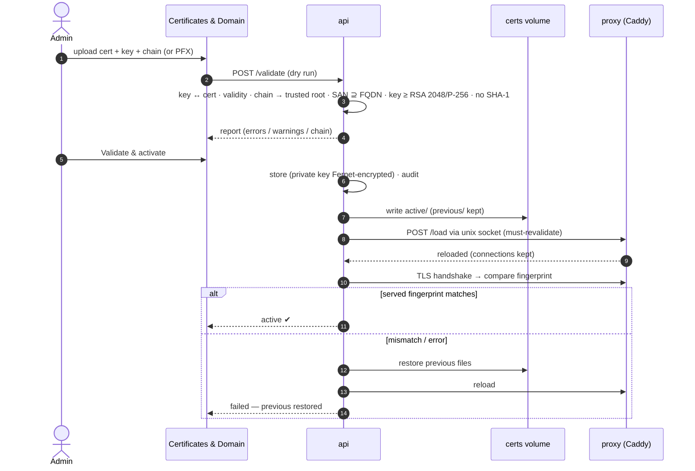

# TLS certificates

The Docker deployment's proxy serves the certificate managed in **Settings → Certificates & Domain**
(`settings:manage`; installing requires `features.ui_tls_management: true`, ACME also `features.acme: true`).

## Modes

| Mode | When | How |
|---|---|---|
| Self-signed | first start (automatic) | generated by `init` for the FQDN; regenerated when the FQDN changes; banner until replaced |
| Uploaded | internal / commercial CA | PEM (separate files or one bundle), PKCS#12/PFX, pasted PEM, or a CSR generated in the UI |
| ACME | internet-reachable FQDN | Let's Encrypt (or an internal ACME CA) via HTTP-01 or DNS-01 (Route 53, Cloudflare) |

## Install flow

## Generate a CSR

Choose the common name (pre-filled with the FQDN), extra SANs, organisation fields and key type (RSA
2048/3072/4096 or ECDSA P-256/P-384). The private key is generated and kept (encrypted) on the server. Download
the CSR, have it signed, then upload the signed certificate under the pending request — it is matched to the
key by its public key. Cancelling a request destroys its key.

## Validation rules

| Check | Rejected when |
|---|---|
| Key match | the private key does not belong to the certificate |
| Validity | expired, or not yet valid (warning under 14 days left) |
| Chain | it does not build to a public root, a root in the **Trusted CA bundle**, or a root included in the upload (the last is accepted with a warning: clients must trust it) |
| Domain | the SANs do not cover the FQDN (wildcards match one label) |
| Strength | RSA < 2048 bits, ECDSA below P-256 |
| Signatures | MD5 or SHA-1 anywhere in the chain |
| Type | a CA certificate, or a self-signed server certificate |

## Rollback

**Roll back to previous** re-activates the previous certificate — including the generated self-signed one
after your first install. A failed activation restores the previous certificate automatically.

## ACME

1. Point the FQDN at the host and open ports 80/443 (HTTP-01), or choose DNS-01 and provide credentials in
   `.env`: `EXCAT_ACME_CLOUDFLARE_API_TOKEN`, or AWS credentials / instance role for Route 53.
2. Set `features.acme: true`, run `./run.sh`, then enable ACME on the page with a contact email (optional:
   staging or internal ACME directory URL; an internal CA's root goes in the Trusted CA bundle).

The proxy obtains and renews the certificate itself; the generated configuration is saved on the certs
volume and survives restarts (it is validated at start, with a fall back to the default if invalid).

## Expiry and security

- Expiry emails at 30, 14, 7 and 1 days to admins with an email address (needs SMTP), plus a banner.
- TLS 1.2+ (1.3 preferred) with Caddy's modern cipher suites; HTTP redirects to HTTPS; HSTS per `hsts`.
- Private keys are never displayed or exported; every install, rollback, CSR and ACME change is audited.
- The API reaches the proxy only through its admin unix socket — never TCP, never the Docker socket.
