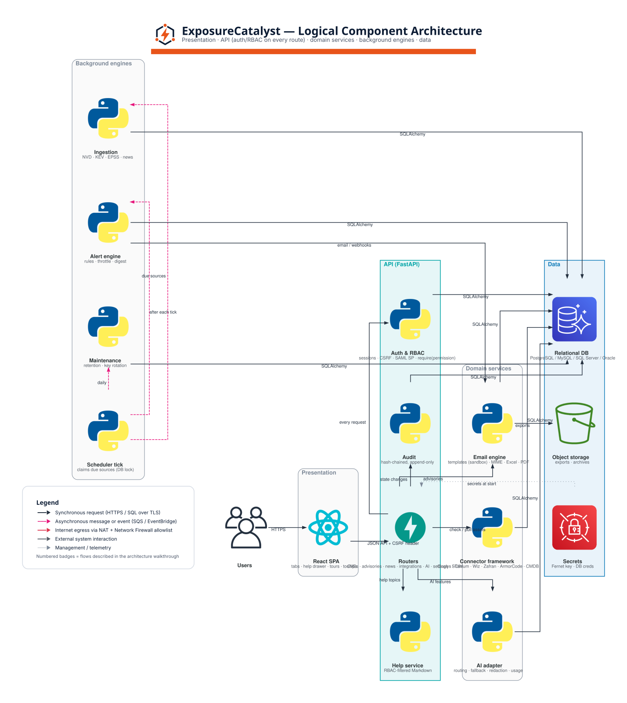

# Logical component architecture

<figure markdown>
  
  <figcaption>Figure 6. Application components and their dependencies. Downloads: <a href="../../assets/diagrams/components.png">PNG 300 DPI</a> · <a href="../../assets/diagrams/components.drawio">editable draw.io</a> · source <code>docs/diagrams/components.py</code></figcaption>
</figure>

| Component | Package | Responsibility |
|---|---|---|
| React SPA | `frontend/` | Tabs, help drawer, tooltips, guided tours. No secrets. Strict CSP |
| Routers | `exposurecatalyst.api` | REST API. Every route depends on `require(permission)` (tested) |
| Auth & RBAC | `security`, `sso` | Sessions, CSRF, Argon2id, TOTP, SAML SP, SCIM, group → role mapping |
| Audit | `security.audit` | Hash-chained append-only log (PostgreSQL trigger) |
| Help service | `help` | Markdown help shared with the docs, filtered by permission |
| Email engine | `advisories` | Sandboxed templates, branded Outlook-safe HTML, MIME/.eml, Excel, PDF, SMTP |
| Connector framework | `connectors` | Plugin interface, 24 asset-source connectors, 4 action connectors (tickets / chat), field mapping, CMDB enrichment |
| AI adapter | `ai` | Provider catalog, routing and fallback, redaction, fencing, usage and cost |
| Scheduler tick | `ingestion.scheduler` | 60-second tick. DB-claimed per source, so safe with several replicas |
| Ingestion | `ingestion`, `news` | NVD, KEV, EPSS and news sources |
| Alert engine | `alerts` | Rule evaluation and delivery |
| Maintenance | `maintenance` | Retention (daily), secret re-encryption (key rotation) |
