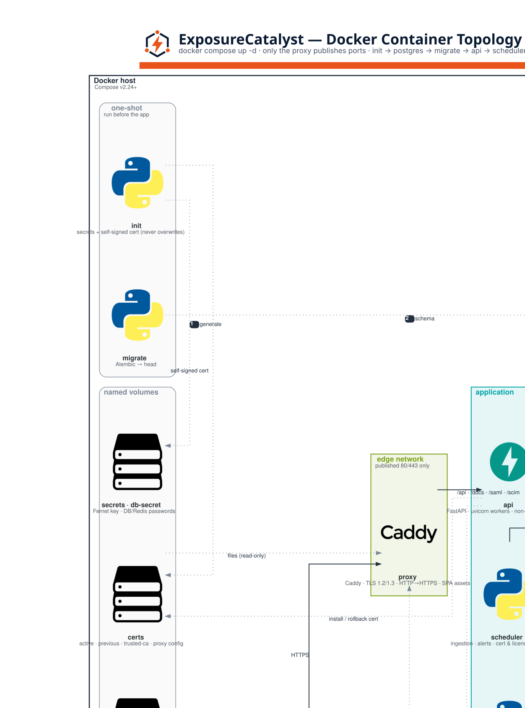

# Container topology (Docker deployment)

<figure markdown>
  
  <figcaption>Figure 12. Docker deployment: containers, networks and volumes. Downloads: <a href="../../assets/diagrams/container_topology.png">PNG 300 DPI</a> · <a href="../../assets/diagrams/container_topology.drawio">editable draw.io</a> · source <code>docs/diagrams/container_topology.py</code></figcaption>
</figure>

| Service | Image | Role | Networks | Notes |
|---|---|---|---|---|
| `init` | app | one-shot: secrets + self-signed certificate | none | never overwrites; reuses `EXCAT_ENCRYPTION_KEY` / `POSTGRES_PASSWORD` when set |
| `postgres` | postgres 16 (digest-pinned) | bundled database | backend | skipped with an external database |
| `migrate` | app | one-shot Alembic upgrade | backend | api/scheduler start only after it succeeds |
| `api` | app | FastAPI (uvicorn workers) | edge, backend, egress | trusts X-Forwarded-For only from the edge subnet |
| `scheduler` | app | ingestion, alerts, certificate expiry, subscriptions | backend, egress | heartbeat healthcheck |
| `proxy` | Caddy (xcaddy build) | TLS, HTTP→HTTPS, SPA assets | edge | **only published service**; listens on 8080/8443 inside, non-root, no capabilities |
| `worker` / `redis` | app / redis 7.4 | profile `scale` | backend (+egress) | duplicate-safe job runners; Redis provisioned for future queue use |
| `backup` | postgres 16 | profile `backup` | backend | `pg_dump` into the `backups` volume |
| `ollama` | ollama | profile `ollama` | backend, egress | local LLM |
| `direct` | proxy image | profile `direct` | edge | plain HTTP on 127.0.0.1:8000 (previous behaviour) |

**Hardening.** Images pinned by version and digest; non-root users; read-only root filesystems with tmpfs `/tmp`;
`no-new-privileges`; all capabilities dropped (none added — the proxy binds high ports and is published on
80/443); resource limits; json-file log rotation; healthchecks on every long-running service; the Docker
socket is never mounted. The proxy's admin API listens only on a unix socket in a volume shared with the
API container. The `backend` network is internal (no route out).

**Volumes.** `pgdata`, `secrets` (encryption key, 0700), `db-secret` (database/Redis passwords, group-readable
by postgres only), `certs`, `uploads`, `exports`, `backups`, `caddy-data`, `caddy-config`, `caddy-admin`,
`redis`, `ollama`.
