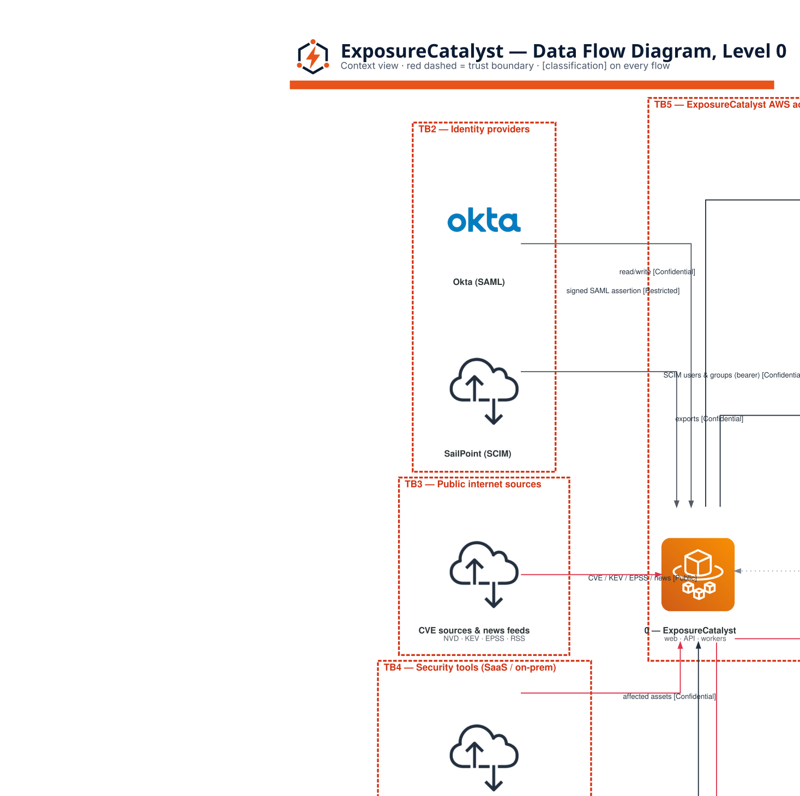
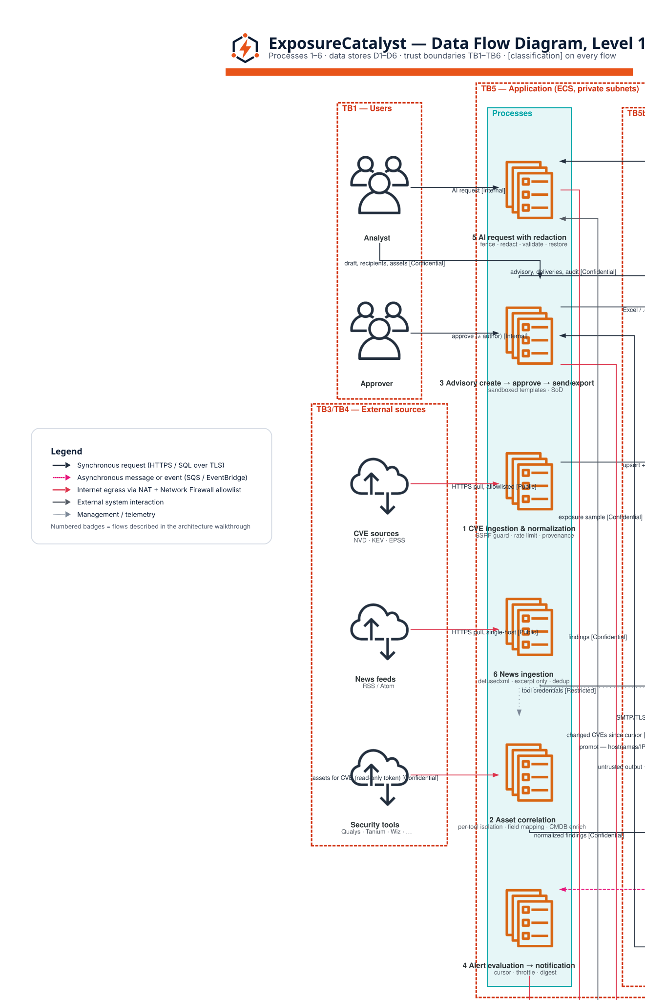

# Data flow diagrams

Trust boundaries are drawn as red dashed boxes (TB1–TB6). Every flow is labelled with what moves and its data classification (see [Security overview](../security/overview.md#data-classification)).

## Level 0 — context

<figure markdown>
  
  <figcaption>Figure 4. ExposureCatalyst in context. Downloads: <a href="../../assets/diagrams/dfd_level0.png">PNG 300 DPI</a> · <a href="../../assets/diagrams/dfd_level0.drawio">editable draw.io</a> · source <code>docs/diagrams/dfd_level0.py</code></figcaption>
</figure>

## Level 1 — core flows

<figure markdown>
  
  <figcaption>Figure 5. Processes 1–6 with stores D1–D6. Downloads: <a href="../../assets/diagrams/dfd_level1.png">PNG 300 DPI</a> · <a href="../../assets/diagrams/dfd_level1.drawio">editable draw.io</a> · source <code>docs/diagrams/dfd_level1.py</code></figcaption>
</figure>

| # | Process | Inputs → outputs | Key controls |
|---|---|---|---|
| 1 | CVE ingestion & normalization | NVD/KEV/EPSS (Public) → D1 | Egress allowlist, SSRF guard, rate limits, retries, KEV truncation guard, provenance |
| 2 | Asset correlation | Tools (Confidential) + D4 credentials (Restricted) → D2 | Read-only service accounts, vendor-host pinning, per-tool isolation, result caps, CMDB enrichment |
| 3 | Advisory create → approve → send/export | Analyst input, D2 → D3, D5, recipients | Sandboxed templates, SoD (author ≠ approver), exports only when approved, header-injection guard, audit |
| 4 | Alert evaluation → notification | D1 changes → email / Slack / Teams | Once per rule × CVE, throttle/digest, encrypted, host-allowlisted webhooks |
| 5 | AI request with redaction | Analyst request + D2 sample → AI provider → user | Policy and allowlist, redaction and restore, fencing, no tools, validated outputs, budget |
| 6 | News ingestion | RSS/Atom (Public) → D6 | defusedxml, single-host fetch, excerpt only, de-duplication |

The STRIDE analysis of each trust boundary is in the [threat model](../security/threat-model.md).
