# Data model

The schema is managed by Alembic (`migrations/`) and uses only portable types (`JSON`, `DateTime(timezone=True)`,
`String(n)`), named constraints, and `IN`-list batching of at most 500 values. That keeps it compatible
with PostgreSQL, MySQL/MariaDB, SQL Server, Oracle and SQLite.

## Entity-relationship diagram (Phase 1)

```mermaid
erDiagram
    users ||--o{ user_roles : has
    roles ||--o{ user_roles : grants
    roles ||--o{ role_permissions : contains
    users ||--o{ user_sessions : owns
    users ||--o{ saved_searches : owns
    cves ||--o{ cve_products : affects
    cves ||--o{ cve_events : timeline
    source_state ||--o{ job_runs : "runs (by source)"
    advisory_templates ||--o{ advisory_template_versions : versions
    advisory_template_versions ||--o{ advisories : "rendered with"
    advisories ||--o{ advisory_source_status : matrix
    advisories ||--o{ advisory_assets : assets
    advisories ||--o{ advisory_deliveries : "sends / exports"
    users ||--o{ advisories : authors
    roles ||--o{ group_role_mappings : "granted via"
    scim_groups ||--o{ scim_group_members : members
    users ||--o{ scim_group_members : "member of"
    alert_rules ||--o{ alert_events : matches
    group_role_mappings { int id PK
      string group_name
      int role_id FK }
    scim_groups { string id PK "uuid"
      string display_name UK }
    alert_rules { int id PK
      json criteria
      json channels
      text webhooks_enc "Fernet"
      datetime cursor_at }
    alert_events { int id PK
      string cve_id
      string status }
    news_feeds ||--o{ news_items : publishes
    ai_providers ||--o{ ai_usage : "metered by"
    news_items { int id PK
      string canonical_url UK
      string title
      string summary "≤300 chars excerpt"
      json cve_ids
      json tags
      int cluster_id }
    ai_providers { int id PK
      string kind
      string base_url
      text secrets_enc "Fernet"
      json config "api_version, region, prices" }
    ai_usage { int id PK
      string feature
      int input_tokens
      int output_tokens
      float cost_usd
      bool redacted }
    integrations ||--o{ integration_cve_checks : "checked CVEs"
    integrations ||--o{ asset_findings : "reports"
    integrations ||--o{ integration_vuln_map : "CVE → vendor IDs"
    integrations { int id PK
      string kind "qualys|tanium|wiz|zafran|armorcode|servicenow_cmdb"
      string base_url
      json config "options + field_map"
      text secrets_enc "Fernet JSON" }
    integration_cve_checks { int id PK
      string cve_id
      string status "ok|error|unsupported"
      int asset_count
      bool truncated }
    asset_findings { int id PK
      string cve_id
      string hostname
      string ip_address
      string resource_id
      string owner }
    advisories { int id PK
      string advisory_id UK "EXCAT-YYYY-NNNN"
      string cve_id
      string status "draft|in_review|approved|sent|cancelled"
      string subject
      json to_addrs
      int created_by FK
      int approved_by FK }
    advisory_template_versions { int id PK
      int version
      string status
      text body_template "sandboxed Jinja" }
    advisory_source_status { int id PK
      string source
      bool integrated
      int manual_count }
    advisory_assets { int id PK
      string source
      string hostname
      string ip_address
      string resource_id
      bool is_manual }
    advisory_deliveries { int id PK
      string channel "smtp|eml|html|pdf|xlsx|clipboard"
      json recipients
      string message_id }
    users {
      int id PK
      string username UK
      string email UK
      string password_hash "Argon2id; NULL for SSO"
      text totp_secret_enc "Fernet-encrypted"
      bool totp_enabled
      int failed_login_count
      datetime locked_until
    }
    roles { int id PK
      string name UK
      bool is_system }
    role_permissions { int id PK
      int role_id FK
      string permission }
    user_sessions { string token_hash PK "SHA-256 of cookie"
      int user_id FK
      string csrf_token
      bool mfa_verified
      datetime expires_at
      datetime last_seen_at }
    cves { int id PK
      string cve_id UK
      string severity
      float cvss_score
      float epss_score
      bool kev
      date kev_due_date
      bool exploit_available
      json cvss_metrics
      json references
      json provenance }
    cve_products { int id PK
      int cve_pk FK
      string vendor
      string product
      string cpe }
    cve_events { int id PK
      int cve_pk FK
      string event_type
      datetime occurred_at }
    source_state { string source PK
      string status
      datetime cursor_at
      json meta }
    job_runs { int id PK
      string source
      string status }
    saved_searches { int id PK
      int user_id FK
      json query }
    audit_log { int id PK
      string action
      string prev_hash
      string hash UK }
    app_settings { string key PK
      json value }
```

## Data dictionary

| Table.field | Type | Description | Source |
|---|---|---|---|
| `cves.cve_id` | string(32), unique | CVE identifier, upper-case | NVD / KEV |
| `cves.title` | string(512) | KEV vulnerability name, otherwise the first sentence of the description | KEV / derived |
| `cves.description` | text | English description (untrusted text, rendered as plain text) | NVD (KEV stub) |
| `cves.vuln_status` | string(64) | NVD analysis status | NVD |
| `cves.severity` | string(16) | CRITICAL/HIGH/MEDIUM/LOW/NONE/UNKNOWN from the headline CVSS | derived |
| `cves.cvss_score` / `cvss_version` / `cvss_vector` | float / string | Headline CVSS (preference order configurable) | NVD |
| `cves.cvss_metrics` | JSON list | Every assessment: `{version, score, vector, severity, source, type}` | NVD |
| `cves.epss_score` / `epss_percentile` / `epss_date` | float / float / date | EPSS probability, percentile and model date | FIRST |
| `cves.epss_checked_at` | datetime | Last EPSS lookup (avoids re-asking hourly) | system |
| `cves.kev`, `kev_date_added`, `kev_due_date`, `kev_required_action`, `kev_ransomware_use` | bool / date / text | CISA KEV fields | KEV |
| `cves.exploit_available` / `exploit_refs` | bool / JSON | Public exploit reference or KEV listing | NVD / KEV |
| `cves.patch_refs` | JSON | References tagged Patch / Vendor Advisory / Mitigation / Release Notes | NVD |
| `cves.cwes` | JSON | CWE IDs | NVD |
| `cves.references` | JSON | `{url, source, tags}`, http(s) only, de-duplicated by URL | NVD |
| `cves.provenance` | JSON | `{field: {source, at}}` for every merged field | system |
| `cves.published_at` / `last_modified_at` | datetime (UTC) | NVD publication and last modification | NVD |
| `cve_products.*` | | Vendor, product, CPE 2.3 string, version range bounds, vulnerable flag, source | NVD / KEV |
| `cve_events.event_type` | string | PUBLISHED, MODIFIED, KEV_ADDED, KEV_REMOVED, EPSS_CHANGED | system |
| `source_state.cursor_at` | datetime | NVD: end of the last fully ingested lastModified window | system |
| `source_state.meta` | JSON | KEV: `etag`, `catalog_version` | system |
| `source_state.refresh_requested_at` | datetime | Pending **Refresh now** | user |
| `user_sessions.token_hash` | string(64) | SHA-256 of the session cookie. The raw token is never stored | system |
| `advisories.advisory_id` | string(20), unique | `EXCAT-YYYY-NNNN`, from `advisory_sequences` (row-locked per year) | system |
| `advisories.status` | string | draft → in_review → approved → sent, or cancelled | workflow |
| `advisories.to_addrs` / `cc_addrs` / `bcc_addrs` | JSON | Validated, lower-cased recipient lists (**Confidential**) | analyst |
| `advisories.template_version_id` | FK | The exact template version used (kept even after newer approvals) | system |
| `advisory_source_status.manual_count` | int, nullable | Analyst count. 0 = checked, none found; NULL = not recorded | analyst |
| `advisory_assets.*` | | Hostname, IP, OS, cloud account, resource ID, owner, BU, environment, detection date, plugin/QID/ID, `is_manual` (**Confidential**) | analyst / connectors |
| `advisory_deliveries` | | Channel, actor, time, recipients, Message-ID, status, error for every send and export | system |
| `integrations.secrets_enc` | text | Fernet-encrypted JSON of the connector's secret fields (**Restricted**). Never returned or logged | admin |
| `integrations.config` | JSON | Non-secret options and `field_map` overrides, validated against the connector spec | admin |
| `integrations.state` | JSON | Connector bookkeeping, e.g. Qualys `kb_synced_at` | system |
| `integration_cve_checks` | | One row per (integration, CVE): status, asset count, truncated flag, error. Drives *No* vs *Not Integrated* | system |
| `asset_findings` | | Normalized affected assets per (integration, CVE), replaced on each check (**Confidential**) | connectors |
| `integration_vuln_map` | | CVE → vendor vulnerability ID (Qualys QIDs) | connectors |
| `users.auth_source` / `sso_groups` / `scim_id` / `external_id` | | `local`/`saml`/`scim`. Groups from SAML or SCIM drive roles. SCIM resource ID and SailPoint identity ID | IdP / SCIM |
| `group_role_mappings` | | Group name → role. The only source of SSO users' roles | admin |
| `saml_requests` / `saml_assertions` | | Outstanding AuthnRequest IDs (single use, 10 min) / consumed assertion IDs (replay cache) | system |
| `scim_tokens.token_hash` | string(64) | SHA-256 of the bearer token (**Restricted**). The token is shown once | admin |
| `scim_groups` / `scim_group_members` | | SCIM groups and memberships pushed by SailPoint | SCIM |
| `alert_rules` | | Criteria, recipients, channels, encrypted webhooks, mode, throttle/digest, cursor | admin |
| `alert_events` | | One per (rule, CVE): reason, matched/delivered time, status | system |
| `news_feeds` | | Name, https URL, category, enabled, health, ETag | admin / curated defaults |
| `news_items` | | Headline, link, canonical URL (unique), ≤300-char excerpt, date, CVE IDs, tags, cluster ID. Retained 90 days | feeds (public) |
| `ai_providers` | | Provider kind, endpoint, models, temperature/max tokens, config (api_version, region, project, prices), encrypted secrets (**Restricted**) | admin |
| `ai_usage` | | One row per AI call: user, feature, provider, model, tokens, cost, latency, redacted flag, status/error. **No prompt or response text** | system |
| `distribution_lists` | | Named reusable To/CC/BCC sets | analyst |
| `audit_log.prev_hash` / `hash` | string(64) | Hash chain: `sha256(prev_hash + canonical_json(row))` | system |

## Retention (defaults; configurable in Phase 6)

| Data | Retention |
|---|---|
| CVE records, products, events | Indefinite (public data) |
| `job_runs` | 90 days |
| `user_sessions` (expired or revoked) | 30 days |
| `audit_log` | ≥ 1 year online, then archived to S3 with Object Lock (compliance mode) |
| Saved searches | Until the user is deleted |
