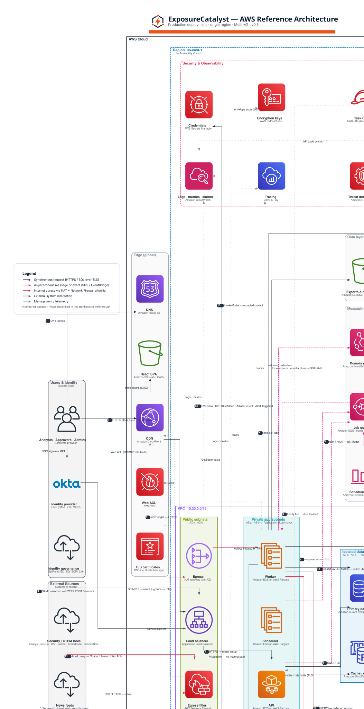

# High-level AWS architecture

The production reference deployment runs in a single AWS Region across at least two Availability Zones.
Multi-region DR (Aurora Global Database, S3 Cross-Region Replication, Route 53 failover) and the detailed
network architecture are documented in Phase 6.

<figure markdown>
  
  <figcaption>Figure 1. ExposureCatalyst on AWS (single region, Multi-AZ). Click to open full size.
  Downloads: <a href="../../assets/diagrams/aws_high_level.png">PNG 300 DPI</a> ·
  <a href="../../assets/diagrams/aws_high_level.drawio">editable draw.io</a> ·
  source <code>docs/diagrams/aws_high_level.py</code></figcaption>
</figure>

## Components by layer

| Layer | Component (AWS service) | Responsibility |
|---|---|---|
| **Edge (global)** | DNS (Amazon Route 53) | Public hostname, health-checked failover records (DR) |
| | CDN (Amazon CloudFront) | Serves the React SPA from S3 through Origin Access Control and forwards `/api/*` and `/docs/*` to the ALB |
| | Web ACL (AWS WAF) | AWS managed rule groups (Core, Known Bad Inputs, SQLi), login rate-based rules, geo/IP restrictions. Attached to CloudFront and the ALB |
| | TLS certificates (AWS Certificate Manager) | TLS 1.2+ certificates for CloudFront and the ALB |
| **Public subnets** | Load balancer (ALB) | HTTPS listener and target group for the API tasks. Its security group accepts only the CloudFront managed prefix list |
| | Egress filter (AWS Network Firewall) | Stateful **domain allowlist** for all outbound traffic (CVE sources, news, integrations, AI vendors, SMTP) |
| | NAT gateway (one per AZ) | Outbound internet for private subnets, inspected by Network Firewall |
| **Private app subnets** | API (Amazon ECS on Fargate) | FastAPI. Auth, RBAC, REST API, help, docs |
| | Worker (ECS on Fargate) | Ingestion, asset correlation, email sending, AI calls. Consumes SQS |
| | Scheduler (ECS on Fargate, 1 task) | 60-second tick that enqueues due sources. *Alternative:* EventBridge Scheduler |
| | VPC endpoints | PrivateLink/Gateway endpoints for S3, Secrets Manager, KMS, SQS, CloudWatch Logs, ECR. AWS API calls never cross the internet |
| **Isolated data subnets** | Amazon Aurora PostgreSQL (Multi-AZ) | System of record. No route to the internet. Encrypted with a KMS CMK |
| | Amazon ElastiCache for Redis | Shared rate limiting, cache, optional Celery broker. In-transit and at-rest encryption, AUTH |
| **Messaging** | Amazon SQS | `ingest`, `correlate` and `email` queues, each with a dead-letter queue (DLQ) |
| | Amazon EventBridge event bus | Domain events: `CVE.New`, `CVE.KEVAdded`, `Advisory.Sent`, `Alert.Triggered` |
| **Data** | Amazon S3 | Excel exports, email archive and docs. SSE-KMS, versioning, Block Public Access, TLS-only bucket policy |
| **Managed AI & email** | Amazon SES / Amazon Bedrock | Advisory delivery. Optional in-account LLM |
| **Security & observability** | Secrets Manager, KMS, IAM | Credentials (rotated), CMKs per data class, one least-privilege task role per service |
| | CloudWatch, X-Ray, CloudTrail, GuardDuty, Security Hub | Logs, metrics and alarms, tracing, API audit, threat detection, posture (CIS / FSBP) |

## Numbered flows

| # | Flow | Protocol / notes |
|---|---|---|
| 1 | Users resolve the app hostname | Route 53 |
| 2 | Browser loads the SPA and calls `/api` | HTTPS via CloudFront. WAF inspects every request |
| 3 | SSO: Okta posts the SAML assertion to the ACS endpoint (Phase 4) | HTTPS POST `/saml/acs`. SailPoint provisions over SCIM 2.0 |
| 4 | CloudFront forwards `/api/*` to the ALB | HTTPS, custom origin header verified by the ALB |
| 5 | ALB routes to API tasks | HTTPS, security group allows ALB → API on 8000 only |
| 6 | API reads and writes the database | PostgreSQL over TLS (`sslmode=verify-full`) |
| 7 | API enqueues long-running jobs (refresh, exports, sends) | SQS via VPC endpoint |
| 8 | Scheduler tick (or EventBridge Scheduler, `rate(1 hour)`) enqueues due ingestion jobs | SQS |
| 9 | Workers long-poll SQS | SQS via VPC endpoint |
| 10 | Workers fetch NVD, KEV and EPSS hourly | HTTPS egress, NAT, Network Firewall allowlist |
| 11 | Workers query integrations for affected assets (Phase 3) | HTTPS egress. Credentials from Secrets Manager |
| 12 | Workers upsert normalized CVEs and assets | PostgreSQL over TLS |
| 13 | Workers publish domain events that drive alerts (Phase 4) | EventBridge |
| 14 | Advisory email sent | SES, or SMTP/TLS 587 to Microsoft 365 / corporate relay |
| 15 | AI request with hostnames, IPs and owners redacted first (Phase 5) | Bedrock InvokeModel, or HTTPS to an allowlisted vendor |

## Trust boundaries (summary)

1. **Internet → edge**: WAF, TLS, CloudFront.
2. **Edge → VPC**: ALB accepts CloudFront only, and the app enforces authN/authZ.
3. **App → data**: isolated subnets, security groups, DB TLS, least-privilege DB role.
4. **App → internet**: Network Firewall domain allowlist, plus the app-level SSRF guard (defence in depth).
5. **App → AWS APIs**: VPC endpoints with endpoint policies, and IAM task roles.

The full STRIDE threat model and Level 0/1 data-flow diagrams follow in Phase 6.

## Resilience

All tiers are Multi-AZ: ALB, NAT per AZ, ECS services spread across AZs, Aurora writer plus a replica in
another AZ, ElastiCache replication group. The API and workers are stateless; session state is in the DB.
Losing an AZ removes capacity but not availability.

## Local equivalent

`docker-compose.yml` mirrors the logical architecture: `postgres` (Aurora), `api`, `scheduler` (worker and
scheduler combined in single-node mode) and an optional `redis` profile.
