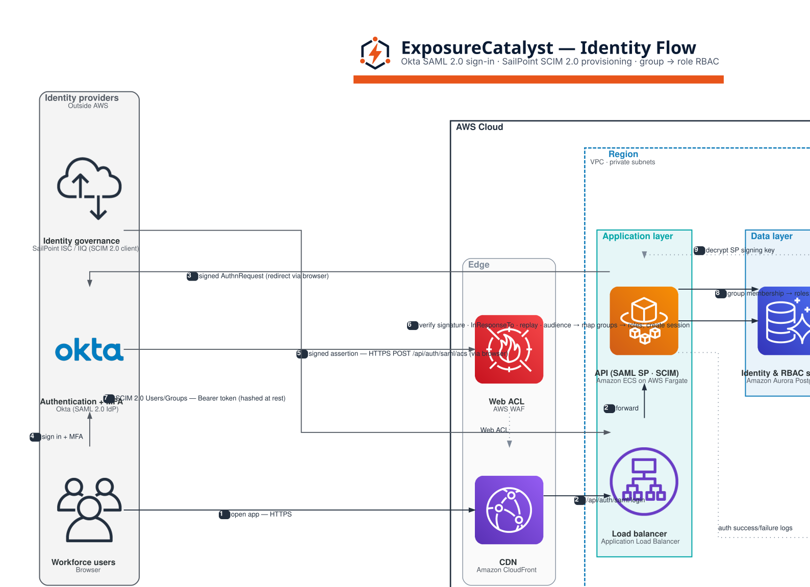
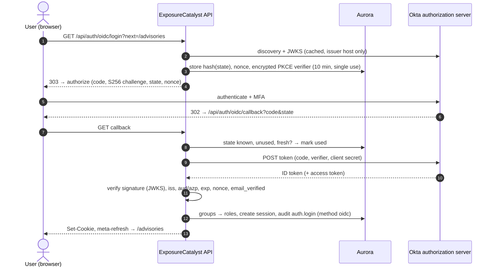
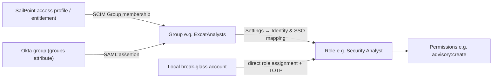

# Identity flow

<figure markdown>
  
  <figcaption>Figure 2. Okta SAML 2.0 sign-in and SailPoint SCIM 2.0 provisioning feeding group → role RBAC.
  Downloads: <a href="../../assets/diagrams/identity_flow.png">PNG 300 DPI</a> ·
  <a href="../../assets/diagrams/identity_flow.drawio">editable draw.io</a> · source <code>docs/diagrams/identity_flow.py</code></figcaption>
</figure>

## Numbered flows

| # | Flow | Controls |
|---|---|---|
| 1 | The user opens ExposureCatalyst | CloudFront and AWS WAF |
| 2 | **Sign in with Okta** calls `/api/auth/saml/login?next=…` | `next` must be an internal path (no open redirect) |
| 3 | The SP builds a **signed AuthnRequest** (RSA-SHA256) and redirects the browser to Okta | The request ID is stored server-side, single use, valid 10 minutes |
| 4 | The user authenticates at Okta. Okta enforces MFA | ExposureCatalyst marks SSO sessions MFA-verified, so enforce MFA in the Okta sign-on policy |
| 5 | Okta's browser POST delivers a **signed assertion** to `/api/auth/saml/acs` | Exempt from Origin/CSRF checks (cross-site by design). The SAML signature is the integrity control |
| 6 | The SP validates the assertion | Strict mode: signature (no SHA-1), audience, recipient/destination (built from `EXCAT_PUBLIC_URL`), time window, `InResponseTo` matched to step 3, assertion-ID replay cache. A local account can't be bound. Groups map to roles, and no mapped role means no access |
| 7 | SailPoint provisions **SCIM 2.0** Users and Groups with a bearer token | The token is shown once and stored as SHA-256. SCIM routes use no cookie session |
| 8 | Group membership changes recompute roles and **revoke sessions** of affected users | Least privilege takes effect immediately |
| 9 | The SP signing key is decrypted with the Fernet key from Secrets Manager (KMS) | The key is never stored in plaintext |

## Session handoff after SAML

The ACS response sets the `__Host-` session cookie (`SameSite=Strict`). A Strict cookie isn't sent on a
navigation that started cross-site, so a plain HTTP redirect after Okta's POST would arrive without it. The
ACS therefore returns a tiny page with `<meta http-equiv="refresh">` to the target path. That navigation
starts from our own origin, so the cookie is sent. No inline script is involved, so the strict CSP is kept.

## OpenID Connect alternative

OIDC (Authorization Code + PKCE) replaces steps 2–6 when it's enabled. Steps 7–9 (SCIM, group → role mapping,
session) are identical. See the [Okta OIDC guide](../admin-guide/okta-oidc.md).

The callback is a cross-site top-level navigation, so it uses the same same-origin meta-refresh hop as the SAML
ACS for the `SameSite=Strict` session cookie.

## Authorization model

See [Users & RBAC](../admin-guide/rbac.md) and [SailPoint](../admin-guide/sailpoint.md).
