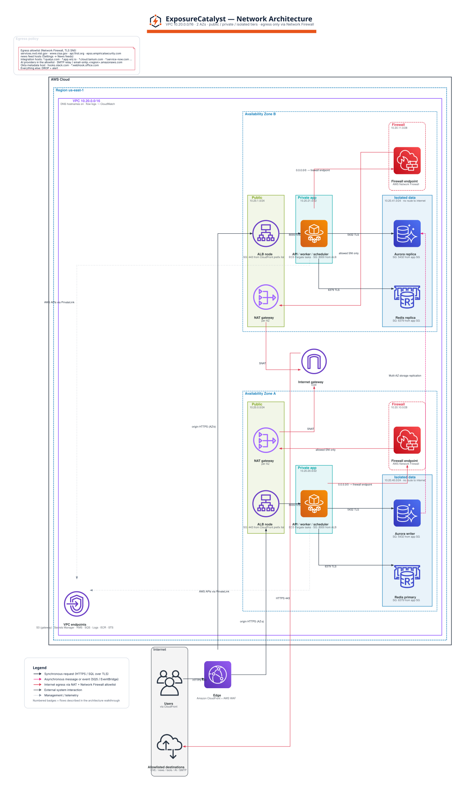

# Network architecture

<figure markdown>
  
  <figcaption>Figure 3. VPC, subnets per AZ, endpoints, NAT and Network Firewall egress. Downloads: <a href="../../assets/diagrams/network.png">PNG 300 DPI</a> · <a href="../../assets/diagrams/network.drawio">editable draw.io</a> · source <code>docs/diagrams/network.py</code></figcaption>
</figure>

## Subnet plan (per AZ)

| Tier | CIDR (AZ-a / AZ-b) | Contents | Default route |
|---|---|---|---|
| Public | 10.20.0.0/24 · 10.20.1.0/24 | ALB nodes, NAT gateways | Internet gateway. Return route to app CIDR via the firewall endpoint (symmetric inspection) |
| Firewall | 10.20.10.0/28 · 10.20.10.16/28 | AWS Network Firewall endpoints | NAT gateway (same AZ) |
| Private app | 10.20.20.0/22 · 10.20.24.0/22 | ECS Fargate tasks (API, scheduler) | **Network Firewall endpoint**, the only internet path |
| Isolated data | 10.20.40.0/24 · 10.20.41.0/24 | Aurora, ElastiCache | **None** (no internet route) |

## Security groups

| SG | Inbound | Outbound |
|---|---|---|
| ALB | 443 from CloudFront origin-facing prefix list | 8000 to app subnets |
| App | 8000 from ALB SG | 443 and 587 (filtered by Network Firewall), 5432 and 6379 to data subnets |
| DB | 5432 from App SG | — |
| Redis | 6379 from App SG | — |
| VPC endpoints | 443 from App SG | — |

## Egress control

1. App subnets send `0.0.0.0/0` to the **Network Firewall** endpoint in their AZ.
2. A STRICT-ORDER stateful rule group allows only the configured domains (TLS SNI and HTTP Host). Everything
   else is **dropped and alerted** to CloudWatch Logs.
3. Allowed traffic leaves through the AZ's NAT gateway and the internet gateway.
4. AWS API calls (S3, Secrets Manager, KMS, SQS, Logs, ECR, STS, EventBridge, optional Bedrock) never leave the
   VPC: they use **VPC endpoints**.
5. The application enforces the same allowlist (`EXCAT_EGRESS_ALLOWLIST`) plus DNS-rebinding and private-range
   checks (defence in depth). New feeds, integrations, AI providers or SMTP relays must be added to **both**.

The allowlist is the Terraform variable `egress_domains`, which feeds both the firewall and the app setting.
