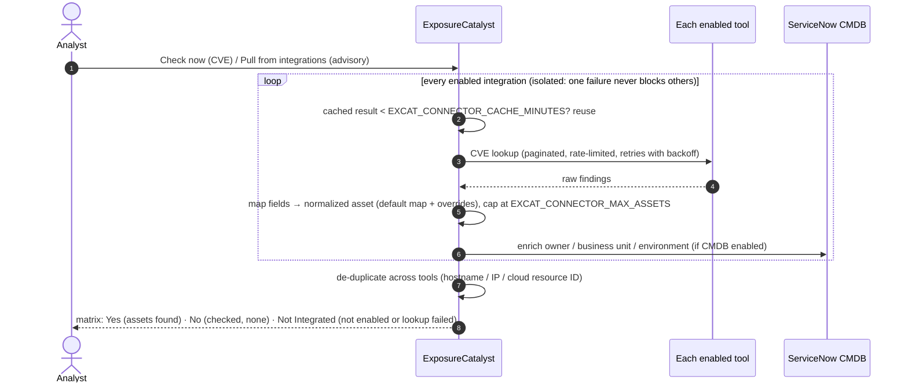

# Integrations

Connectors ask your security and CTEM tools **which assets are affected by a CVE**. Results feed the CVE
detail *Affected assets* panel, the advisory **asset validation matrix**, and the Excel attachment.
**Action connectors** (ticketing and notifications) create a ticket or post a message for an approved
advisory instead; they are never queried for assets.

| Category | Connector | Matrix row | What it does | API defaults |
|---|---|---|---|---|
| Vulnerability & exposure | [CrowdStrike Falcon Spotlight](crowdstrike.md) | CrowdStrike Falcon Spotlight | Spotlight combined vulnerabilities, FQL `cve.id` | Documented API |
| Vulnerability & exposure | [Microsoft Defender Vulnerability Management](defender.md) | Microsoft Defender VM | `SoftwareVulnerabilitiesByMachine` filtered by `cveId` | Documented API |
| Vulnerability & exposure | [Qualys VMDR](qualys.md) | Qualys | CVE → QIDs (KnowledgeBase), then Host List Detection | Documented API |
| Vulnerability & exposure | [Rapid7 InsightVM](rapid7.md) | Rapid7 InsightVM | Integrations API v4 asset search with a vulnerability filter | **Confirm defaults** |
| Vulnerability & exposure | [Tanium](tanium.md) | Tanium | Gateway GraphQL, endpoints filtered by a CVE sensor | Documented API |
| Vulnerability & exposure | [Tenable Security Center (Tenable.sc)](tenable-sc.md) | Tenable Security Center | Analysis API `listvuln`, filter `cveID` | Documented API |
| Vulnerability & exposure | [Tenable Vulnerability Management (Tenable.io)](tenable.md) | Tenable Vulnerability Management | Workbench assets filtered by `plugin.attributes.cve.raw` | Documented API |
| Cloud security (CNAPP) | [Orca Security](orca.md) | Orca | Serving-layer query on `CveId` (configurable) | **Confirm defaults** |
| Cloud security (CNAPP) | [Prisma Cloud (Compute / CWPP)](prisma-cloud.md) | Prisma Cloud | Compute impacted-resources stats for the CVE | Documented API |
| Cloud security (CNAPP) | [Wiz](wiz.md) | Wiz | GraphQL `vulnerabilityFindings` filtered by CVE | Documented API |
| Application security (SCA / code) | [Checkmarx One](checkmarx.md) | Checkmarx One | SCA results of each project's latest scan | Documented API |
| Application security (SCA / code) | [Mend.io](mend.md) | Mend | Security findings of each project | **Confirm defaults** |
| Application security (SCA / code) | [Snyk](snyk.md) | Snyk | Reporting API issues filtered by identifier | Documented API |
| Asset inventory (CAASM) | [Armis Centrix](armis.md) | Armis | AQL `in:devices vulnerabilities:(id:…)` | **Confirm defaults** |
| Asset inventory (CAASM) | [Axonius](axonius.md) | Axonius | AQL on `software_cves.cve_id` | Documented API |
| Asset inventory (CAASM) | [runZero](runzero.md) | runZero | Vulnerability export searched by CVE | **Confirm defaults** |
| Asset inventory (CAASM) | [ServiceNow CMDB](servicenow-cmdb.md) | ServiceNow CMDB | Vulnerability Response vulnerable items + CMDB **enrichment** | Documented API |
| Exposure management (CTEM / RBVM) | [ArmorCode](armorcode.md) | ArmorCode | REST findings filtered by CVE (configurable) | **Confirm defaults** |
| Exposure management (CTEM / RBVM) | [Brinqa](brinqa.md) | Brinqa | Data-model query on `cveIds` (configurable) | **Confirm defaults** |
| Exposure management (CTEM / RBVM) | [Cisco Vulnerability Management (Kenna)](kenna.md) | Cisco Vulnerability Management | Vulnerability search + asset lookups | **Confirm defaults** |
| Exposure management (CTEM / RBVM) | [Nucleus Security](nucleus.md) | Nucleus | Project findings search by `finding_cve` (configurable) | **Confirm defaults** |
| Exposure management (CTEM / RBVM) | [Vulcan Cyber](vulcan.md) | Vulcan | Vulnerabilities filtered by CVE (configurable) | **Confirm defaults** |
| Exposure management (CTEM / RBVM) | [XM Cyber](xm-cyber.md) | XM Cyber | Entities filtered by CVE (configurable) | **Confirm defaults** |
| Exposure management (CTEM / RBVM) | [Zafran](zafran.md) | Zafran | REST findings filtered by CVE (configurable) | **Confirm defaults** |
| Ticketing | [Jira (Cloud / Data Center)](jira.md) | — | Creates an issue from an approved advisory | Documented API |
| Ticketing | [ServiceNow ITSM](servicenow-itsm.md) | — | Creates an incident (or other task) | Documented API |
| Notifications | [Microsoft Teams](teams.md) | — | Posts an Adaptive Card via a Workflows webhook | Documented API |
| Notifications | [Slack](slack.md) | — | Posts the advisory to a channel | Documented API |

*API defaults*: **Documented API** connectors follow the vendor's public API reference. **Confirm defaults**
connectors target vendors whose API reference is tenant-gated: their endpoint, filter, body and field map are
editable settings with sensible defaults. Confirm them against your tenant's API docs, then **Check now** on a
CVE you know is present before enabling. No connector has been exercised against a live tenant by the
ExposureCatalyst maintainers; all are covered by tests against recorded/mocked vendor responses.

## How correlation works

- **Validated = Yes** only when the tool returned affected assets. **No** means the tool was queried
  successfully and found none. A failed lookup stays **Not Integrated** and shows its error in the pull
  summary.
- Integration rows are replaced on each pull. **Manual** rows and counts are kept.
- Results are cached per integration and CVE for `EXCAT_CONNECTOR_CACHE_MINUTES` (60). **Check now** and
  *force* pulls bypass the cache.

## Security model

| Control | Detail |
|---|---|
| Least privilege | Each guide lists the minimum read-only role or scope. Never use an admin account |
| Credentials | Fernet-encrypted at rest (KMS + Secrets Manager in AWS). Never returned by the API, logged or audited |
| Egress / SSRF | Base URLs must be `https` on the vendor's SaaS domains (or `EXCAT_EGRESS_ALLOWLIST`). DNS results are checked against private and metadata ranges. Pagination and redirect links are only followed on the same host. In AWS, add each tool's API host to the Network Firewall allowlist |
| Untrusted data | Tool responses are treated as untrusted: parsed with hardened XML/JSON parsers, truncated to column limits, rendered as text |
| Query injection | Values interpolated into vendor query languages (ServiceNow encoded queries) are sanitized. GraphQL uses variables, never string concatenation |
| Isolation | Each integration's errors are captured per check. Timeouts: `EXCAT_CONNECTOR_TIMEOUT_SECONDS` |

## Field mapping

Every connector has a default mapping from its record to the normalized asset model (`hostname`,
`ip_address`, `os`, `cloud_account`, `resource_id`, `owner`, `business_unit`, `environment`,
`detection_date`, `source_ref`). Override any field under **Field mapping (advanced)**:

- dotted paths: `vulnerableAsset.ipAddresses.0` (list index), `cmdb_ci.owned_by`
- a list without an index is joined: `asset.tags` → `"prod, pci"`
- constants: `=Production`

## Adding a connector (developers)

Subclass `exposurecatalyst.connectors.base.Connector`, declare a `ConnectorSpec` (fields, host patterns,
default field map, prerequisites, rate limit), implement `test_connection()` and
`iter_findings(cve_id)`, decorate the class with `@register`, add a guide page here, and add a mocked test.
The settings UI, validation and correlation pick it up automatically.
