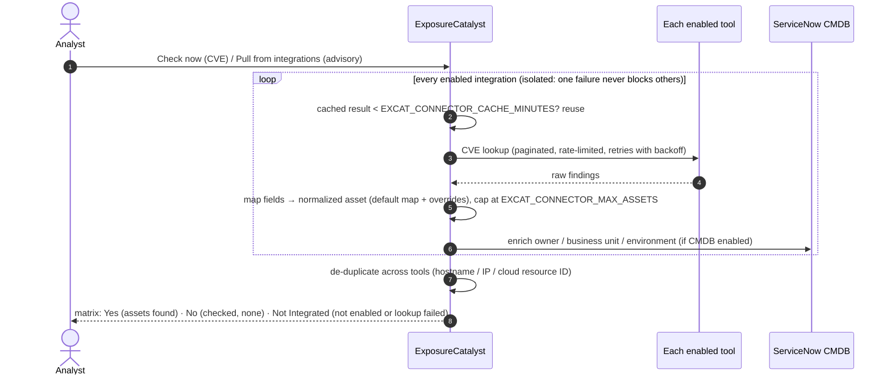

# Integrations

Connectors ask your security and CTEM tools **which assets are affected by a CVE**. Results feed the CVE
detail *Affected assets* panel, the advisory **asset validation matrix**, and the Excel attachment.

| Connector | Matrix row | How it finds affected assets | Auth |
|---|---|---|---|
| [Qualys VMDR](qualys.md) | Qualys | CVE → QIDs (KnowledgeBase), then Host List Detection | Basic (API user) |
| [Tanium](tanium.md) | Tanium | Gateway GraphQL, endpoints filtered by a CVE sensor | API token |
| [Wiz](wiz.md) | Wiz | GraphQL `vulnerabilityFindings` filtered by CVE | OAuth2 client credentials |
| [Zafran](zafran.md) | Zafran | REST findings filtered by CVE (configurable) | API token |
| [ArmorCode](armorcode.md) | ArmorCode | REST findings filtered by CVE (configurable) | API key |
| [ServiceNow CMDB](servicenow-cmdb.md) | ServiceNow CMDB | Vulnerability Response vulnerable items, plus CMDB **enrichment** of every other source | Basic (integration user) |

## How correlation works

- **Validated = Yes** only when the tool returned affected assets. **No** means the tool was queried
  successfully and found none. A failed lookup stays **Not Integrated** and shows its error in the pull
  summary.
- Integration rows are replaced on each pull. **Manual** rows and counts are kept.
- Results are cached per integration and CVE for `EXCAT_CONNECTOR_CACHE_MINUTES` (60). **Check now** and
  *force* pulls bypass the cache.

## Security model

| Control | Detail |
|---|---|
| Least privilege | Each guide lists the minimum read-only role or scope. Never use an admin account |
| Credentials | Fernet-encrypted at rest (KMS + Secrets Manager in AWS). Never returned by the API, logged or audited |
| Egress / SSRF | Base URLs must be `https` on the vendor's SaaS domains (or `EXCAT_EGRESS_ALLOWLIST`). DNS results are checked against private and metadata ranges. Pagination and redirect links are only followed on the same host. In AWS, add each tool's API host to the Network Firewall allowlist |
| Untrusted data | Tool responses are treated as untrusted: parsed with hardened XML/JSON parsers, truncated to column limits, rendered as text |
| Query injection | Values interpolated into vendor query languages (ServiceNow encoded queries) are sanitized. GraphQL uses variables, never string concatenation |
| Isolation | Each integration's errors are captured per check. Timeouts: `EXCAT_CONNECTOR_TIMEOUT_SECONDS` |

## Field mapping

Every connector has a default mapping from its record to the normalized asset model (`hostname`,
`ip_address`, `os`, `cloud_account`, `resource_id`, `owner`, `business_unit`, `environment`,
`detection_date`, `source_ref`). Override any field under **Field mapping (advanced)**:

- dotted paths: `vulnerableAsset.ipAddresses.0` (list index), `cmdb_ci.owned_by`
- a list without an index is joined: `asset.tags` → `"prod, pci"`
- constants: `=Production`

## Adding a connector (developers)

Subclass `exposurecatalyst.connectors.base.Connector`, declare a `ConnectorSpec` (fields, host patterns,
default field map, prerequisites, rate limit), implement `test_connection()` and
`iter_findings(cve_id)`, decorate the class with `@register`, add a guide page here, and add a mocked test.
The settings UI, validation and correlation pick it up automatically.
