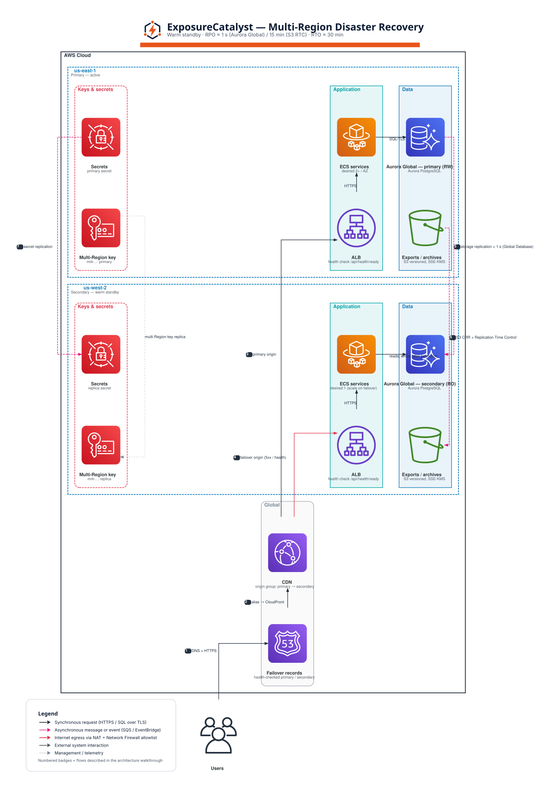

# Disaster recovery

<figure markdown>
  
  <figcaption>Figure 7. Warm-standby multi-region design. Downloads: <a href="../../assets/diagrams/dr.png">PNG 300 DPI</a> · <a href="../../assets/diagrams/dr.drawio">editable draw.io</a> · source <code>docs/diagrams/dr.py</code></figcaption>
</figure>

!!! warning "Implementation status"
    The reference Terraform provisions the **primary region only** (Multi-AZ). The secondary region below is
    the recommended design; add it as a second instance of the stack with Aurora Global Database, S3
    replication and multi-Region KMS keys when your DR requirements call for regional failover.

## Objectives

| Scenario | Protection | RPO | RTO |
|---|---|---|---|
| Task or instance failure | ECS replaces tasks; ALB health checks | 0 | Minutes |
| AZ failure | Multi-AZ ALB, ECS, Aurora (writer failover), Redis | 0 | < 5 min |
| Data corruption / operator error | Aurora point-in-time restore (14 days) | Seconds to minutes | 1–2 h (RB-10) |
| Region failure | Warm standby in a second region (design) | ≈ 1 s (Aurora Global), 15 min (S3 RTC) | ≈ 30 min |

CVE, KEV, EPSS and news data can always be re-ingested from public sources, so the critical data is
advisories, the audit log, configuration and encrypted secrets.

## Design (warm standby)

- **Aurora Global Database** replicates to a read-only secondary cluster.
- **S3** exports bucket with Cross-Region Replication (Replication Time Control).
- **KMS multi-Region keys** and **Secrets Manager replica secrets**, so the same `EXCAT_ENCRYPTION_KEY`
  decrypts in both regions.
- **ECS** in the secondary runs at minimum capacity (API desired 1, scheduler desired **0**) so only one
  scheduler writes at a time.
- **Route 53 failover** (or CloudFront origin failover) on `/api/health/ready`.

## Failover procedure

1. Declare the incident. Confirm the primary is unavailable (not a monitoring false positive).
2. Promote the secondary: `aws rds failover-global-cluster --global-cluster-identifier <id> --target-db-cluster-identifier <secondary-arn>`
   (managed failover), or detach and promote the secondary for an unplanned outage.
3. Scale the secondary: API to the normal count, **scheduler to 1**.
4. Switch traffic: Route 53 health check flips automatically, or update the record manually.
5. Verify: sign in through Okta (the IdP's ACS URL is the same hostname), `/api/health/ready`,
   `exposurecatalyst audit-verify`, source health.
6. Communicate the recovery. Note any advisories sent in the last minutes before the outage and check their
   delivery records.

## Failback

1. Rebuild the original region as the new secondary (Aurora Global re-attach).
2. Scale the scheduler to 0 in the region that will become secondary **before** promoting.
3. Run a managed switchover in a maintenance window and verify as above.

## Testing

Exercise an AZ failover (`aws rds failover-db-cluster`) and a point-in-time restore at least quarterly, and
a regional failover game-day yearly. Record the measured RTO and RPO.
