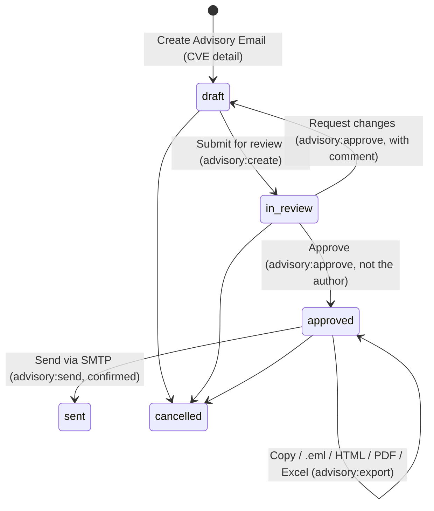

# Advisories: analyst & approver guide

The Advisory Email Generator (Tab 2) turns a CVE and its affected assets into a reviewed, branded email for
stakeholders. Each advisory carries a unique **advisory ID** (`EXCAT-YYYY-NNNN`) in the subject, banner and
footer, so it can be referenced in tickets and replies.

## Lifecycle

- **Drafts** are editable by anyone with `advisory:create`. While **in review** or later, the content is locked.
- **Segregation of duties.** The author of an advisory can't approve it. The server enforces this even for
  users who hold both roles.
- **Nothing leaves the platform unapproved.** Send, Copy for Outlook, `.eml`, HTML, PDF and Excel are all
  refused until the advisory is approved. Otherwise downloading a draft `.eml` would bypass review.

## Creating an advisory

From **CVE Intelligence → CVE detail**, click **Create Advisory Email**. The draft is pre-filled:

| Field | Pre-filled from |
|---|---|
| Severity | CVE headline severity. KEV-listed CVEs without a score default to *High* |
| Template | Severity: Critical → *Critical*, High → *High*, otherwise *Informational* |
| Summary / title | NVD description / KEV vulnerability name |
| Affected products | CPE vendor and product |
| Remediation | CISA KEV *required action* (if listed) plus vendor patch references |
| SLA due date | KEV due date, otherwise Critical 7 / High 14 / Medium 30 / Low 90 days |
| Subject | Template, for example `[CRITICAL] EXCAT-2026-0042 Security Advisory: CVE-2024-21762 – Fortinet Fortios – 12 assets affected` |

## Editing an advisory

See the in-app help on the editor page (**?**) for step-by-step instructions. Key points:

- **Recipients.** To, CC and BCC addresses are validated. Distribution lists add recipients in one click.
- **Asset validation matrix.** One row per source (`EXCAT_ADVISORY_SOURCES`). **Validated = Yes only when
  affected assets were actually identified for that source.** A manual count of `0` records "checked, none
  found" (*No*). Sources with nothing recorded show *Not Integrated*.
- **Total unique affected assets.** Rows are de-duplicated across sources by hostname (case- and
  trailing-dot-insensitive), IP address and cloud resource ID. Manual counts without rows are added on top,
  and the email says so.
- **Manual entries** (typed, uploaded or counted) are labelled **Manual** in the matrix, the email and the
  Excel file.
- **CSV/XLSX upload.** The file needs a header row. Limits are `EXCAT_UPLOAD_MAX_BYTES` (5 MB) and
  `EXCAT_UPLOAD_MAX_ROWS` (10,000). Formulas in XLSX files are never evaluated.

## Delivery options

| Option | What you get | Logo |
|---|---|---|
| **Send via SMTP** | Sent from the configured relay to To, CC and BCC (BCC only in the SMTP envelope, never in headers), with the Excel file attached. A confirmation dialog lists every recipient | Inline CID image |
| **Copy for Outlook** | Rich HTML on the clipboard. Paste into a new Outlook message and attach the Excel file yourself | Base64 image, survives paste |
| **Download .eml** | An Outlook-ready draft (`X-Unsent: 1`) with recipients, subject, body and the Excel attachment. Opens as an editable, unsent message | Inline CID image |
| **HTML / PDF** | A standalone copy for tickets or archives | Embedded image |
| **Excel** | `EXCAT-YYYY-NNNN_<CVE>_affected_assets.xlsx` | Logo on the Summary sheet |

Every delivery and export is recorded with **what, how, to whom and by whom**: the *Audit trail* panel, the
`advisory_deliveries` table and the hash-chained audit log.

### The email

The layout is fixed and Outlook-safe: table-based, inline styles, no SVG. From top to bottom:

1. **Header**: the ExposureCatalyst wordmark on white with an orange rule.
2. **Severity banner**: uses the severity palette, never brand orange.
3. **Body**: summary table (severity, CVSS, EPSS, KEV, exploit status, products, unique assets, SLA, owner),
   summary, business impact, remediation, workaround, and the validation matrix.
4. **Footer**: *Generated by ExposureCatalyst · Advisory ID · timestamp*.

A plain-text part is included for accessibility.

### The Excel workbook

| Sheet | Contents |
|---|---|
| Summary | Logo, advisory details, validation matrix |
| All Assets (Deduplicated) | One row per unique asset, with merged sources and plugin/QID/IDs |
| One sheet per source | That source's rows |

Header rows are navy with white bold text and frozen, and columns are fitted to content. Cells that begin
with `=`, `+`, `-` or `@` are written as text with a leading apostrophe, so they can't run as formulas.

## Templates

Four system templates ship with v1 approved: **Critical**, **High**, **Informational** and **Executive**.
Admins (`template:manage`) create new versions, which another person must approve (`advisory:approve`).
Advisories keep the version they were created with.

Template bodies are rendered in a **sandboxed** Jinja environment with autoescaping. Template authors can't
reach application internals, and CVE or analyst text can't inject HTML. The header, severity banner and
footer are code-owned, so branding and the advisory-ID footer can't be removed.

## For approvers

1. Open **Advisories** and filter by **in review**.
2. Check the preview, the recipients (who will receive this?), the matrix (is *Validated = Yes* backed by
   assets?) and the SLA.
3. **Approve**, or **Request changes** with a comment. The comment is shown to the author and recorded in the
   audit log.
